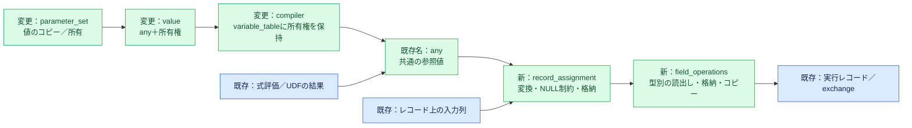

# 型・値操作の共通基盤

`any`と`value`の名前を維持し、値の表現と所有権を分ける。`any`を参照値の共通表現にし、`value`は同じ`any`と、必要なデータの所有権を保持する。所有側に別の型一覧・variant・型index変換表を持たない。

## この資料の読み方

図1で全体の経路を確認し、値と寿命、型別操作、SQL代入と検索キー変換の順に読む。末尾の検証ケースから対応するUTを参照する。

## 図1. パラメーターからSQL実行まで

## 値と寿命

- [any.h](../../src/jogasaki/data/any.h)は、NULL、評価エラー、型付きの値を保持する共通表現である。比較・表示の型別switchを削除し、variantの比較と訪問処理へまとめる。
- [value.h](../../src/jogasaki/data/value.h)と[value.cpp](../../src/jogasaki/data/value.cpp)は、`any`と必要な所有権だけを持つ。`value::copy(any)`は長い文字列・バイナリとprovided LOBのlocatorをコピーして所有する。value同士のコピーでは、短い値はインラインの内容をコピーし、長いデータとlocatorは不変の所有領域を共有する。move後の元オブジェクトはNULLになる。
- [variable_table.h](../../src/jogasaki/executor/process/impl/variable_table.h)の`retain()`が、コンパイル後に使うパラメーターの所有権を保持する。[compiler.cpp](../../src/jogasaki/plan/compiler.cpp)は、LOBだけの特別処理や`value_to_any()`を通さず、同じ`any`を直接レコードへ格納する。

`value::view()`は所有権を移さず値を返す。長いデータを参照する場合は、所有する`value`を存続させる。レコードの文字列・バイナリをクエリ用resourceへコピーするか、そのまま参照するかは`field_operations`のresource引数で選ぶ。外部のLOB object IDの有効期間は、引き続きdatastoreとtransactionが管理する。

## 読出し・コピー・格納

[field_operations.h](../../src/jogasaki/data/field_operations.h)と[field_operations.cpp](../../src/jogasaki/data/field_operations.cpp)で、物理型ごとの操作を選ぶ。型別のswitchは一つだけにし、同じ型付き実装からレコード間コピー、レコードから`any`への読出し、`any`からレコードへの格納を作る。

UPDATE・offer・project・VALUESでは、演算子の構築時に型と位置を準備する。各行では準備済みの操作を呼ぶ。NULLは値本体を読み出さずに伝播し、型不一致やコピー失敗の場合は出力のNULLビットを先に変更しない。

## 変換と代入

[record_assignment.h](../../src/jogasaki/executor/conv/record_assignment.h)と[record_assignment.cpp](../../src/jogasaki/executor/conv/record_assignment.cpp)は、論理型・物理型・列位置・NULL制約・assignment／unify／noneを束ねる。INSERT系、UPDATE、offer、project、VALUESが同じ`apply()`を呼ぶ。SQLの型変換規則は既存のassignment／unifyを使い、別のSQL型体系を追加しない。同型レコードの代入は参照を格納し、深いコピーを行わない。呼出し側が参照先の寿命を保つ。resourceは必要なSQL変換結果の確保に使う。

[fill_evaluated_value.h](../../src/jogasaki/executor/wrt/fill_evaluated_value.h)と[fill_evaluated_value.cpp](../../src/jogasaki/executor/wrt/fill_evaluated_value.cpp)は、式評価と評価エラー処理の後、準備済みの代入を呼ぶ非テンプレート関数である。Fieldごとに変換・格納ロジックを再展開しない。

[convert_value.cpp](../../src/jogasaki/data/convert_value.cpp)は、キー向け数値変換の重複した型別分岐を共通化する。整数縮小の範囲外は上下限の分類を返し、浮動小数から整数への非有限値・範囲外と、有限DOUBLEからREALへの上限超過は非対応として入力を変更せず返す。SQLのassignment／unifyとの役割の違いは保持する。

## 削除した実装

`binary_string_value.h/.cpp`、`value_to_any.h/.cpp`、`copy_field_data.h/.cpp`、`convert_any.h/.cpp`を削除する。旧APIへ転送するヘッダーやaliasは作らない。`value`の独立variant、`body()`、`ref<T>()`、型index変換も削除し、利用側を`copy()`／`view()`／`retain()`へ変更する。

## 検証

[所有値のテスト](../../test/jogasaki/data/value_test.cpp)、[共通操作の追加テスト](../../test/jogasaki/data/field_operations_test.cpp)、[従来のコピー試験](../../test/jogasaki/utils/copy_field_data_test.cpp)に加え、SQLパラメーターの型別変換、INSERT FROM SELECT、project、VALUES、UPDATE、offer、式評価、UDF結果、既存wire入出力を実行する。実行先・結果・ソース指紋は作業台の対象作業に記録する。

## 実行前の操作準備

`take_flat`、`take_group`、joinの`group_field`、`emit`、UDF結果の`apply`は、列マッピングの構築時に`field_operations`を保持する。集約キーはpartition構築時、集約関数の入力列は`field_locator`構築時、既定値の出力列は`write_field`構築時に準備する。行ごとの処理では保持した操作を呼び、型選択を繰り返さない。

検索キーは`value_conversion::prepare()`で出力型に対応する変換操作を選び、`search_key_field_info`に保持する。実行時の`apply()`は、実際の入力値の型・NULL・範囲を確認する。入力値の確認は行ごとに必要であり、準備時の出力型選択とは分ける。

compilerの`create_host_variables()`は実行前のパラメーター格納である。ここでの型選択は各パラメーターにつき一度であり、行処理から呼び出されない。

## INSERTの準備とSQL比較

[write_statement](../../src/jogasaki/executor/common/write_statement.h)は、構築時に各タプルの明示列について評価器と代入計画を作る。列省略は計画を作らず、実行時に従来と同じkey→value・列順でデフォルトを評価する。型の異なるタプル間で計画を共有しない。評価器が自身のcompiled_infoを参照するため、statementのcopy/moveは許可しない。行の評価、NULL制約、可変長領域の寿命は実行時に扱う。

projectではYugawaraの型解析が出力変数を元の式へbindするので、正規の計画では両者のSQL型が一致する。VARCHARの長さ・CAST・型付きNULL・型未指定NULLをSQLで検証する。不整合な計画の型検査は残す。

[キー変換](../../src/jogasaki/data/convert_value.h)は入力を変更せず、変換値とexact／切り下げ／切り上げ／整数範囲外／非対応を返す。[検索範囲の生成](../../src/jogasaki/executor/process/impl/ops/details/encode_key.cpp)は等値・prefixの不一致を空結果にし、範囲末尾では上下限の包含条件を補正する。DESCでは論理上のlower／upperを保持する。INT列と範囲外BIGINT値の比較、およびREAL列とDOUBLE値の比較をSQLで確認する。

SQLで許容される型組合せは拡張しない。標準設定のBOOLEAN／SMALLINT定義、整数列と近似数の比較、整数キーへのdecimal変換は既存のエラーを維持する。INT64と近似数の極端な境界など全数値組合せのSQL昇格規則を解決したという意味ではない。

検証ケース：[value_model_sql_test.cpp](../../test/jogasaki/api/value_model_sql_test.cpp)、[field_operations_test.cpp](../../test/jogasaki/data/field_operations_test.cpp)。
